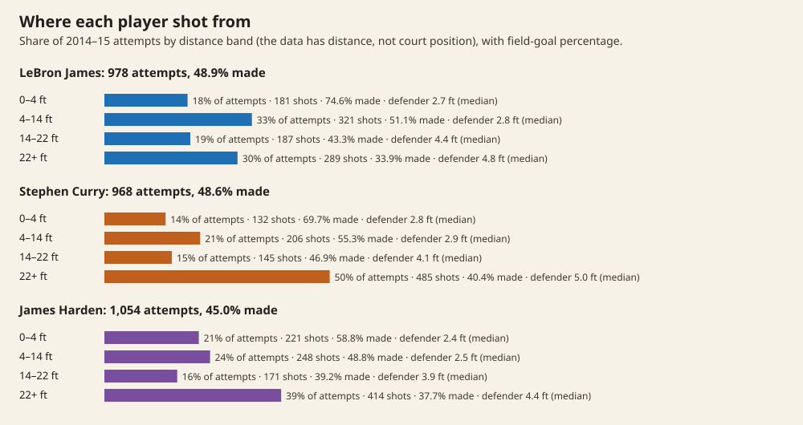
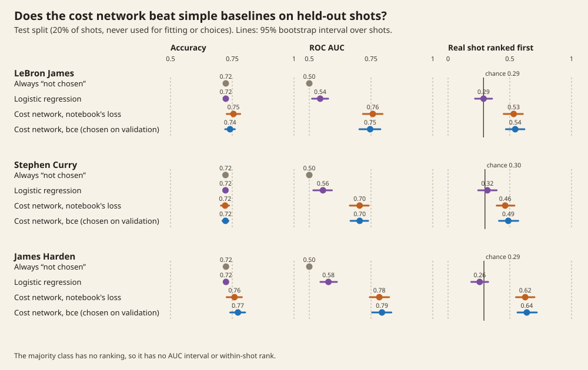
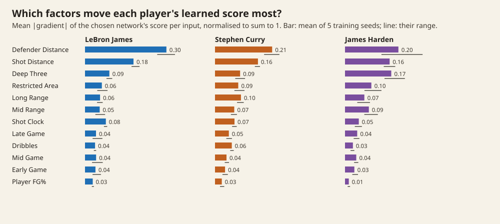

# Modeling NBA shot decisions with inverse optimization

**Author:** Colin Nguyen · **Course:** Math 132B (Professor Atzberger), June 2025 · revised October 2026

Shot analytics usually judge outcomes: did the shot go in? This project asks a
different question: given the shots LeBron James, Stephen Curry and James
Harden actually took in 2014–15, what "cost" were they minimising when they
chose them? Each real shot is treated as the chosen option among a few
plausible alternatives the player didn't take, and a neural network learns a
per-player score that tells the real shot apart from the alternatives.



## What it finds, and how far to trust it

On held-out shots, the network picks out the real shot from its alternatives
far better than chance or a linear model. For LeBron James, the real shot is
ranked first 54% of the time against 29% by chance and 29% for logistic
regression. Curry and Harden show the same pattern.



| Test set (20% of shots, scored once) | Accuracy | ROC AUC | Real shot ranked first (chance) |
|---|---|---|---|
| **LeBron James** · always "not chosen" | 0.724 (0.717–0.731) | 0.5 | – |
| logistic regression | 0.724 | 0.544 (0.511–0.576) | 0.29 (0.22–0.36) |
| network, notebook's loss | 0.755 | 0.757 | 0.53 |
| network, plain BCE (chosen on validation) | 0.741 | 0.747 (0.703–0.788) | 0.54 (0.47–0.62) · chance 0.29 |
| **Stephen Curry** · always "not chosen" | 0.723 (0.714–0.730) | 0.5 | – |
| logistic regression | 0.723 | 0.555 (0.516–0.592) | 0.32 (0.24–0.39) |
| network, notebook's loss | 0.721 | 0.704 | 0.46 |
| network, plain BCE (chosen on validation) | 0.723 | 0.704 (0.667–0.738) | 0.49 (0.41–0.57) · chance 0.30 |
| **James Harden** · always "not chosen" | 0.725 (0.716–0.732) | 0.5 | – |
| logistic regression | 0.725 | 0.578 (0.545–0.612) | 0.26 (0.19–0.33) |
| network, notebook's loss | 0.759 | 0.784 | 0.62 |
| network, plain BCE (chosen on validation) | 0.773 | 0.794 (0.754–0.832) | 0.64 (0.56–0.72) · chance 0.29 |

Brackets are 95% bootstrap intervals over test shots; every interval is in
`results/results.json`. Three caveats matter more than the numbers:

- **Accuracy is the wrong yardstick.** About 72% of rows are generated
  alternatives, so always answering "not chosen" scores 0.72. Logistic
  regression does exactly that. The network adds at most five points of
  accuracy; its real gain is in ranking (AUC, and the real shot ranked first).
- **The alternatives are synthetic, and the network partly learns the
  generator.** The generator proposes more open shots than players actually
  got: the closest defender was more than 6 ft away for 9–21% of real shots
  but for 26–29% of generated alternatives (`results/artifacts.json`). So
  "a tightly guarded option is more likely the real one" is partly a fact
  about the generator, not only about the player. A second artifact was
  checked and ruled out as the driver: about 10% of alternatives carry a zone
  label that doesn't match their distance, but removing or recomputing the
  zone flags changes validation AUC by at most 0.03.
- **The "KKT" part does not shape the cost.** See below.



Defender distance and shot distance move every player's score most, as in the
course run; Harden's score also leans on the deep-three flag. Read the
defender-distance bar with the caveat above: some of its weight reflects how
the alternatives were generated. The bars average five training seeds, and the
lines show how much they vary; for Harden, the ranges for defender distance
and deep three overlap, so their order is not settled.

## Corrections to the 2025 write-up

**Validation BCE.** The original table had Curry's and Harden's values swapped.
From the saved training history (`results/original_run_2025-06-04.json`, the
run behind the notebook's printed outputs), final-epoch validation BCE was:

| Player | Final validation BCE | Lowest during training | Epochs before early stopping |
|---|---|---|---|
| LeBron James | 0.489 | 0.483 | 61 |
| Stephen Curry | 0.536 | 0.528 | 104 |
| James Harden | 0.509 | 0.499 | 39 |

Those numbers came from a row-level random split, in which near-copies of a
validation shot were in training, so they are optimistic. The held-out table
above replaces them.

**"All models converged to low KKT residuals" was wrong.** At the end of
training, the complementary-slackness term was −213.7 (LeBron), −347.2 (Curry)
and −142.4 (Harden), and still falling. As implemented:

- the term is λ·mean(g), which is signed, so minimising it rewards large
  multipliers instead of penalising violations;
- the constraints (shot clock ≥ 0, defender within 10 ft, shot within 35 ft)
  were applied to standardised features, not to seconds and feet;
- the constraints depend only on the inputs and the multipliers, never on the
  network's weights. Complementary slackness and primal feasibility therefore
  cannot change the learned cost; only the "stationarity" term reaches the
  network, and it pushes the cost to be flat.

A corrected version (|λ·g| and relu(g) in real units, `kkt_fixed`) trains
identically to plain BCE, which confirms the last point. Validation chose
plain BCE. The method is best described as a learned choice model over
generated alternatives, not as recovered KKT conditions.

## How it works

1. **Data.** Every 2014–15 shot by the three players (978, 968 and 1,054
   shots). Features: shot distance, closest defender's distance, shot clock,
   dribbles, the player's field-goal percentage so far in the game, a distance
   band (0–4, 4–14, 14–22, 22+ ft) and the game stage.
2. **Alternatives.** For 800 sampled shots per player, up to three perturbed
   versions of the same moment (different distance, defender spacing, shot
   clock) are generated as options the player didn't take
   (`nbashots/alternatives.py`).
3. **Model.** An MLP (12 → 64 → 32 → 16 → 1, LeakyReLU, batch norm, dropout)
   scores each option; trained with binary cross-entropy and AdamW, with early
   stopping on validation (`nbashots/model.py`).
4. **Evaluation.** Split by shot (60/20/20), so a shot and its alternatives
   never straddle a split. Features are standardised on training rows only.
   The model variant is chosen on validation, and the test set is scored once
   (`scripts/evaluate.py`).

Two feature bugs in the course notebook are fixed in the package: shots were
ordered by the game clock as text (so 9:59 came before 11:00), and the running
FG% was shifted across games.

## v2: inverse optimization that constrains the cost (pre-registered; stopped at criterion a)

Everything above is the **v1 audit**: the course model, its corrected
numbers and its held-out comparison. Its pipeline (`nbashots/`, `scripts/`)
is unchanged. v2 is a separate attempt at inverse optimization in which the
optimality conditions actually depend on the learned cost. This section was
written and committed before any v2 code or results.

### Forward problem

A player who has the ball chooses **where to shoot from** and **how long to
hold it**, to maximise expected points minus a personal cost:

    maximise over d = (s, t):   EP(s, t; x) - C(s, t)
    subject to   g1 = -s       <= 0     (feet; distance cannot be negative)
                 g2 = s - 35   <= 0     (feet; longer shots are end-of-clock heaves, excluded)
                 g3 = -t       <= 0     (seconds; touch time cannot be negative)
                 g4 = t - k    <= 0     (seconds; cannot hold the ball past the shot clock)

**Decision variables (chosen by the player):**
- `s`, shot distance in feet (`SHOT_DIST`). Where to shoot is the central
  shot-selection choice; the data has distance but no court x/y, so direction
  (corner, wing, top) cannot be modelled.
- `t`, touch time in seconds (`TOUCH_TIME`): how long the player held the ball
  before shooting. It stands in for dribbles (correlation 0.91 in the data)
  and is continuous, which the optimality conditions need. Shot-clock time at
  release is not a separate choice: it equals k - t.

**Context (given, not chosen):** closest defender distance in feet
(`CLOSE_DEF_DIST`), the shot clock at the catch k = `SHOT_CLOCK` +
`TOUCH_TIME` in seconds, the period, and the player. Defender distance is
treated as context even though a player can partly create space; the data
cannot separate the two. Score margin during the game is not in the data
(only the final margin, which is an outcome), so it is not used.

**Shots used:** touch time above 0, shot clock recorded, k at most 24 s, and
shot distance at most 35 ft. This keeps 108,400 of 128,069 shots, and 809,
750 and 843 for LeBron James, Stephen Curry and James Harden. (3,358 shots have
touch time 0 or less, 10,970 have k above 24 s, 5,567 have no shot clock and
249 are beyond 35 ft.)

**Expected points EP(s, t; x)** = P(make | s, t, x) x (2 + P(three | s)).
P(make) is a small smooth network fitted to makes and misses; P(three | s) is
a logistic curve in distance, because the 3-point line is 22 ft in the corners
and 23.75 ft elsewhere and the data has no position. EP is fitted once, checked
on held-out shots, then **frozen**. It is trained on all other players' shots
plus the three players' training shots; their validation and test shots are
held out of it.

**Personal cost** C(d) = b·d + ½ dᵀQd with Q positive semi-definite (Q = LLᵀ),
one (b, Q) per player, d in feet and seconds. This is the quadratic first
version; an input-convex network is added only if the quadratic clearly
underfits (training stationarity residual explains less than 20% of the
variance of ∇EP).

**Why the flat cost is ruled out.** The optimality conditions are
∇EP(dᵢ) - ∇C(dᵢ) = Σⱼ λᵢⱼ ∇gⱼ(dᵢ). EP is fixed and its gradient is not zero
at most observed shots, so C = constant cannot satisfy them unless every shot
sits on a constraint boundary. The cost must explain why players do not simply
take the highest-EP option.

### Loss

For each player, over training shots i, with multipliers λᵢⱼ = softplus(θᵢⱼ) >= 0
(dual feasibility):

    stationarity     r_i = ∇_d EP(d_i) - ∇_d C(d_i) - Σ_j λ_ij ∇g_j(d_i)    (autograd through EP and C)
    loss             mean ||r_i||²  +  ρ · mean Σ_j λ_ij · (-g_j(d_i))

The complementary-slackness penalty λ·(-g) is never negative (λ >= 0, g <= 0)
and is zero only when each multiplier is zero or its constraint is tight.
Primal feasibility holds for every observed shot by the filters above. ρ is
chosen on validation.

### Success criteria (fixed before any results)

Splits: each player's shots, 60/20/20 by shot, seeded. All choices (ρ, the
expected-points model's settings) are made on validation; the test set is
scored once.

**EP check (prerequisite).** On held-out shots, the predicted make probability
is within 0.03 of the observed rate in every decile, the expected calibration
error is at most 0.02, and the log loss beats a logistic regression on
distance alone.

**(a) Synthetic recovery. If this fails, stop and report; do not fit real
players.** Three synthetic players with known quadratic costs (preferring the
rim, the 3-point range and a mid-range pull-up), on the real players' training
contexts, choose d by solving the forward problem exactly (grid search, 0.25
ft by 0.1 s), plus Gaussian noise (sd 1.0 ft and 0.25 s), clipped to the
feasible set. A cost counts as **recovered** if both hold for all three:
- relative parameter error ||θ̂ - θ*|| / ||θ*|| <= 0.25, with θ = (b, Q);
- on held-out synthetic contexts, decisions solved with θ̂ versus θ* differ by
  a median of at most 1.0 ft and at most 0.25 s.

**(b) Held-out decision prediction on real shots.** For each test shot, solve
the forward problem with the player's learned cost and compare with the actual
(s, t). Baselines: (1) maximise EP alone (C = 0); (2) the player's mean
training decision. Metric: mean absolute error in feet and in seconds. The
model **beats** a baseline on a variable if its MAE is lower and the 95%
bootstrap interval of the paired difference is entirely below zero. v2
**works on real data** if it beats both baselines on shot distance for at
least two of the three players. Touch time is reported the same way.

**(c) Ablation.** Refit with the stationarity term removed (everything else
unchanged) and compare the learned (b, Q) and validation MAE. The stationarity
term **changes what is learned** if the parameters differ by more than 25%
(relative) and the validation MAE differs. Scored on validation, not test.

### Result: stopped at criterion (a)

The expected-points model passed its check on 11,080 held-out shots
(calibration error 0.011, worst decile gap 0.024, log loss 0.654 against
0.673 for distance alone; `results/v2_ep.json`).

**Synthetic recovery failed, so v2 was not fitted to the real players** and
criteria (b) and (c) were not run (`results/v2_synthetic.json`):

| Synthetic player | Parameter error (limit 0.25) | Decision gap, ft / s (limits 1.0 / 0.25) | Recovered |
|---|---|---|---|
| prefers the rim | 0.49 | 0.75 / 0.10 | no |
| prefers 3-point range | 1.01 | 24.75 / 0.70 | no |
| mid-range pull-up | 0.65 | 9.25 / 0.90 | no |
| *no-noise diagnostic:* rim | 0.07 | 0.00 / 0.00 | yes |
| *no-noise:* 3-point range | 0.71 | 17.75 / 0.20 | no |
| *no-noise:* mid-range | 0.44 | 0.00 / 0.00 | no (parameters) |

Why, from the diagnostics:

1. **The cost is not identified by these decisions.** The context the data
   offers (defender distance, shot clock, period) moves the optimal decision
   very little: under the 3-point cost the optimal distance varies by 0.23 ft
   (sd) across real contexts. Stationarity then pins down only one
   combination of b and Q, a ridge of costs that fit equally well. Even
   without noise, the fit reached a residual of 3·10⁻⁶ with the wrong
   curvature.
2. **Stationarity is a local condition, and EP is not concave in distance.**
   EP peaks at the rim, dips through mid-range and jumps at the arc, so a
   cost can make every observed shot a stationary point while the global
   optimum lies elsewhere. Solving with the recovered 3-point cost moves
   shots 17.75 ft away from the true cost's choices.
3. **Noise larger than the signal.** With decision noise of 1 ft and 0.25 s,
   larger than the spread the costs produce, stationarity evaluated at noisy
   (non-optimal) points biases the fit for all three.

Possible next steps, not run: fit by the likelihood of the observed decision
under a choice model over the whole feasible grid, P(d | x) ∝ exp((EP − C)/T),
which uses the global objective rather than local conditions and models noise
directly (a flat cost is still ruled out, since choices would then follow EP
alone); and fewer cost parameters, or context that moves decisions more.
`scripts/v2_real.py` is written but was not run.

## v3: a choice model over the feasible set (pre-registered; stopped at criterion a)

The last attempt. v1 and v2 above are kept as they are. This section was
written and committed before any v3 code or results. If criterion (a) or the
identifiability check fails, v3 stops and is reported as a negative result.

### Model

Same forward problem, data filters, splits (60/20/20 by shot, seeds as in v2),
grid (0.25 ft by 0.1 s, with t <= k) and frozen expected-points model as v2.
Instead of optimality conditions, each observed decision is treated as a draw
from a choice distribution over the feasible grid:

    P(d | x) ∝ exp( (EP(d; x) - C(d)) / T )
    C(d) = β_mid·[4 < s <= 14] + β_long·[14 < s <= 22] + β_three·[s > 22] + α·t

**Five parameters per player:** three distance-band costs relative to the rim
band (a rim cost cannot be identified: adding a constant to every option
changes nothing), a touch-time cost α in points per second, and the
temperature T in points (how closely choices follow EP − C). The bands are the
notebook's. One cost per band rather than a curve keeps each number readable
("worth x points to this player"). Fitting is by maximum likelihood in the
equivalent linear form u = a·EP − b·bands − c·t with a = 1/T, β = b/T, α = c/T.
That log-likelihood is concave, so there is one maximum if the information is
well conditioned. Each observed (s, t) is rounded to its grid cell.

### Success criteria (fixed before any results)

**(a) Synthetic recovery, at v2's noise.** Three synthetic players with the
same characters as v2, in v3's parameters (T in points, β in points, α in
points per second), fixed now:

| Synthetic player | T | β_mid | β_long | β_three | α |
|---|---|---|---|---|---|
| prefers the rim | 0.15 | 0.15 | 0.25 | 0.30 | 0.05 |
| prefers 3-point range | 0.15 | 0.05 | 0.05 | −0.20 | 0.05 |
| mid-range pull-up | 0.15 | −0.15 | −0.15 | 0.10 | 0.02 |

Each uses one real player's training contexts (as in v2). A decision is drawn
from the true choice distribution, then v2's noise is added (Gaussian, sd 1.0 ft
and 0.25 s), clipped to the feasible set and rounded to the grid. A player
counts as **recovered** if:
- the relative error of θ = (T, β_mid, β_long, β_three, α) is at most 0.25;
- the band shares predicted on held-out synthetic contexts with the recovered
  and true parameters differ by a total variation distance of at most 0.05.

**(a′) Identifiability.** From the observed Fisher information at the
maximum, in the linear form (a, b_mid, b_long, b_three, c), for each synthetic
player and then each real player:
- the information matrix is positive definite;
- no pair of parameters has |correlation| above 0.95 (a ridge shows up as a
  correlation near ±1);
- every parameter's standard error is at most 25% of its estimate, or at most
  0.25 in absolute terms (in the linear form's units) when the estimate is
  smaller than 1.

A profile likelihood for each parameter of each synthetic player is also
reported. If (a) or (a′) fails on synthetic data, stop.

**(b) Held-out real shots, test set scored once.** Two baselines:
- **EP alone:** the same choice model with C = 0, so only T is fitted.
- **The player's empirical distribution:** the product of the player's
  training histograms of s (0.25 ft cells) and t (0.1 s cells), each with
  add-one smoothing, restricted to t <= k and renormalised for each shot.

Measures: mean log-likelihood per shot (nats on the shared grid), and the
mean absolute error of predicted shot distance (the model's expected s
against the actual s). v3 is **better** than a baseline for a player if the
95% paired bootstrap interval (1,000 resamples) of the log-likelihood
difference is entirely above zero. v3 **works on real data** if it beats both
baselines for at least two of the three players.

**(c) More than restating frequencies.** The empirical distribution predicts
the same shot distance whatever the context; v3 can shift with context
through EP and the shot-clock limit. On the test shots, for two context
splits, closest defender at or below versus above the player's training
median, and shot clock at the catch at or below 10 s versus above, compare the
observed difference in mean shot distance with the model's predicted
difference. v3 **explains a shift** if the observed difference's 95% bootstrap
interval excludes zero and the predicted difference has the same sign and
lies within that interval. v3 adds something beyond frequencies only if it
explains at least one shift for at least two players. A split with no
observed shift (interval includes zero) is reported as "nothing to explain".

### Result: stopped at criteria (a) and (a′)

All three synthetic players failed both recovery and the identifiability
check, so v3 was not fitted to the real players, and (b) and (c) were not
run (`results/v3_synthetic.json`; `scripts/v3_real.py` is written but has
never been run).

| Synthetic player | θ error (limit 0.25) | Band-share gap (limit 0.05) | Largest correlation | Failing standard error |
|---|---|---|---|---|
| prefers the rim | 5.57 | 0.04 | 0.74 | long-two cost, unbounded |
| prefers 3-point range | 0.38 | 0.03 | 0.87 | long-two cost |
| mid-range pull-up | 0.59 | 0.08 | 0.68 | long-two cost |

What the diagnostics show:

1. **No ridge this time.** Unlike v2, the parameters are not traded off along
   a ridge: the largest correlation is 0.87, and every profile-likelihood
   interval is bounded except one. The choice model fixed the problem it was
   meant to fix.
2. **The long-two band cost could not be pinned down, because the synthetic
   players almost never shot from there:** 0.2%, 0.6% and 5% of their shots
   fell in 14–22 ft. This is a weakness of the synthetic players chosen at
   pre-registration, not of the data. The real players take 14–21% of their
   shots from that band, but the rule was to stop.
3. **Noise at band edges biases the costs.** v2's noise (1 ft) moves shots
   across the 4, 14 and 22 ft edges. That pulls band costs toward zero and
   makes choices look more random: T came out 0.165 and 0.173 against a true
   0.15. Even where the decisions were well predicted (band-share gaps of 0.03
   to 0.04), the parameters were off by 38% or more.

## The three attempts, in order

| | Question | Outcome |
|---|---|---|
| **v1** (course, June 2025; audited October 2026) | Can a network tell a player's real shot from generated alternatives? | Yes on held-out shots: real shot ranked first 49–64% vs 26–32% for logistic regression, chance about 29%. Partly learns the generator; the "KKT" terms never touched the cost. |
| **v2** | Can KKT conditions with a cost inside recover a player's cost? | No. Failed pre-registered synthetic recovery: a ridge of costs fits equally well, and stationarity is only local. |
| **v3** | Can a five-parameter choice model over the feasible set recover it? | No. Failed pre-registered synthetic recovery: no ridge, but the long-two cost was not pinned down from synthetic players who rarely shot there, and edge noise biased the rest. |

No player-cost claim is made from v2 or v3.

## Data

The shot logs are **not included**. They are the public Kaggle dataset
[NBA shot logs](https://www.kaggle.com/datasets/dansbecker/nba-shot-logs)
(dansbecker; 128,069 shots, 2014–15 season, "scraped from NBA's REST API"). Its
licence on Kaggle is listed as **unknown**, so the data and any row-level
derivative stay out of this repository; only aggregates are published.

```bash
# needs a free Kaggle account and the kaggle CLI
kaggle datasets download dansbecker/nba-shot-logs --unzip -p data/
shasum -a 256 data/shot_logs.csv
# e9c7fcd71e6f81ade108841449fe1bccda072ed98fae2b5dc86a3b9f29fe5c7c
```

## Running it

Python 3.12 with [uv](https://docs.astral.sh/uv/); about two minutes on a laptop CPU.

```bash
uv run --python 3.12 --with-requirements requirements.txt python scripts/evaluate.py          # results/results.json
uv run --python 3.12 --with-requirements requirements.txt python scripts/diagnose_artifacts.py # results/artifacts.json
uv run --python 3.12 --with-requirements requirements.txt python scripts/export_demo.py demo.json
python3 scripts/make_figures.py demo.json                                                      # figures/*.svg
```

Set `SHOT_LOGS=/path/to/shot_logs.csv` if the file is not at `data/shot_logs.csv`.

## Layout

| Path | Contents |
|---|---|
| `nbashots/` | Data loading and features, alternative generation, the cost network |
| `scripts/` | Evaluation, artifact check, demo export, figures |
| `results/` | `results.json` (held-out comparison), `artifacts.json`, `original_run_2025-06-04.json` (the course run's saved history) |
| `figures/` | README figures (SVG) |
| `notebooks/course_project_2025.ipynb` | The course notebook as submitted, with a note on its known issues |

## Licence

MIT (`LICENSE`). The shot-log data is not covered and is not included.
